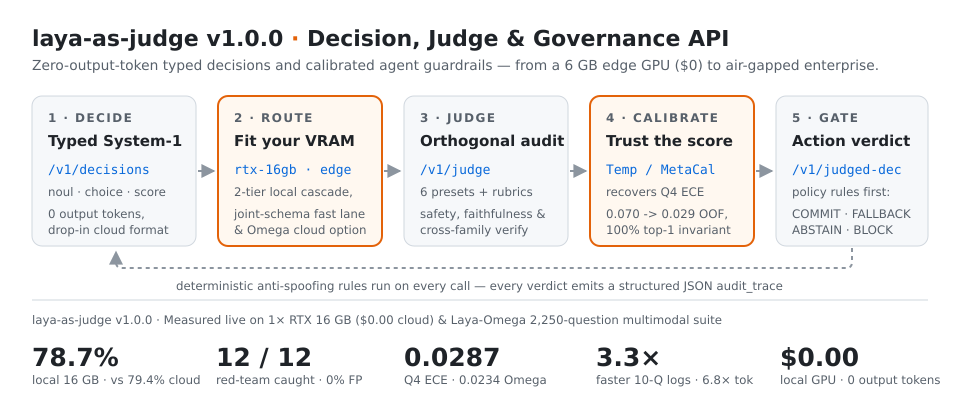
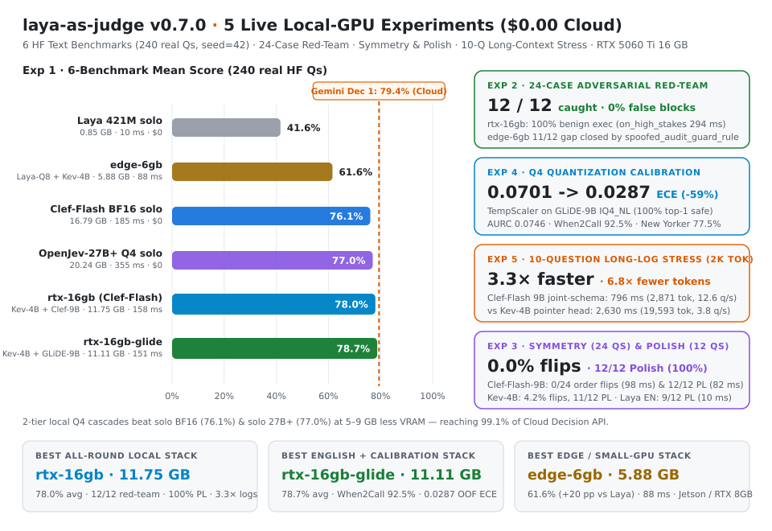
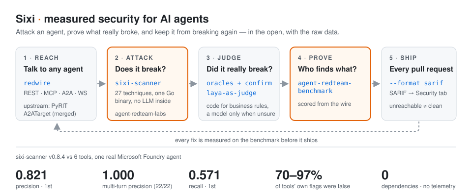

# Radek Brus

**Senior Software Engineer & AI Architect in Switzerland (Locarno) · [Sixi Lab R&D](https://sixi.ai).** 14 years shipping software where failure is expensive — native C++/CUDA inference runtimes, governed enterprise AI agent platforms, and resilient off-grid packet-radio systems. Every number below ships with its script and raw data.

[Sixi Lab R&D (sixi.ai)](https://sixi.ai) · [Work with me](https://sixi.ai/en/work/) · [Sixi Assure](https://sixi.ai/en/assure/) · [Portfolio](https://radeksixi.web.app/) · [Writing (radeksixi.github.io)](https://radeksixi.github.io) · [contact@sixi.ai](mailto:contact@sixi.ai) · [X](https://x.com/radeksixi)

---

## 1. [sixi-asi](https://github.com/radeksixi/sixi-asi) — Hybrid MoE & Gated DeltaNet inference engine

C++20/CUDA speculative-decoding server for hybrid full-attention + `Gated DeltaNet` + sparse MoE models on **NVIDIA Jetson Thor** and **DGX Spark** unified memory, built on llama.cpp with **zero Python** on the runtime path (`v1.0.0` · Apache-2.0 engine sources — [1.0.0 write-up](https://radeksixi.github.io/sixi-asi-1-0-0-qwen3-8-on-one-jetson-thor/), [rc3 write-up](https://radeksixi.github.io/sixi-asi-1-0-rc3-talking-agent-fixes-and-engine-sources/), [rc1 write-up](https://radeksixi.github.io/sixi-asi-1-0-rc1-download-and-run-on-jetson-thor/), [0.11 write-up](https://radeksixi.github.io/sixi-asi-0-11-32-streams-on-jetson-thor/), [0.9 write-up](https://radeksixi.github.io/sixi-asi-0-9-thor-kernels-long-context/)).

<a href="https://radeksixi.github.io/sixi-asi-1-0-rc1-download-and-run-on-jetson-thor/">
  <picture>
    <source media="(prefers-color-scheme: dark)" srcset="assets/sixi-rc1-engines-dark.svg">
    
  </picture>
</a>

| Capability | Measured result on NVIDIA Jetson AGX Thor (`Qwen3.8-27B`) |
|---|---|
| **Speculative decoding** | Lossless **O(1) recurrent-state rollback** + block drafters + 106-line Thor kernel patch: **46.0 tok/s** single-stream on plain GGUF (`TensorRT Edge-LLM NVFP4`: 45.4, `llama.cpp v1.0.0 MTP`: 29.3, plain: 12.1) |
| **Concurrency & memory** | Input-log replay instead of 144 MiB state snapshots per row: **32 concurrent streams at 152 tok/s** with a prompt of its own for each (180 when requests repeat) **in 27 GB** (was 70 GB); 16 long-prompt agents wait **2.8 s** instead of 223 s (**442 s → 2.9 s** worst case) |
| **Multi-role agents & voice** | Reusable system-prompt states cut role calls **2.5–4×** (**1.3 s** vs 3.4 s alone; **6.6 s** vs 26.8 s at 8 sessions); a prompt shared by four requests loads once (**8 s** vs 31 s); schema-constrained JSON **120/120** valid; one-word Polish speech **201/300** right vs 80 |
| **Ship & run (`v1.0.0`)** | Ready-to-run Jetson Thor archive ([download](https://github.com/radeksixi/sixi-asi/releases/tag/v1.0.0)): `./sixi pull && ./sixi chat`, **55 tok/s** single-stream over 60 prompts, `"draft": false` plus a script to compare drafted and undrafted answers (9 of 12 identical, 3.3× faster), OpenAI HTTP/SSE service, cross-request prefix cache (**1.0 s** vs 209 s at 63k context), Apache-2.0 engine sources |

---

## 2. [laya-as-judge](https://github.com/radeksixi/laya-as-judge) — Calibrated Decision, Judge & Governance API (`v1.0.0`)

Zero-output-token **Decision**, **Judge**, and hybrid **The Judged Decision** platform (`v1.0.0` · Apache-2.0 · Python SDK, CLI & FastAPI server) — scaling from a **$0.00 local 6 GB edge or single 16 GB RTX GPU** to air-gapped regulated enterprise (EU AI Act / DORA / NIS2 / [Sixi Assure](https://sixi.ai/en/assure/)) and multimodal `Laya-Omega` ([v1.0.0 solo & enterprise write-up](https://radeksixi.github.io/laya-as-judge-1-0-decision-judge-governance-for-everyone-and-enterprise/), [5 live local GPU experiments](https://radeksixi.github.io/laya-as-judge-0-7-local-decision-api-five-experiments/), [11/11 Laya-Omega write-up](https://radeksixi.github.io/laya-as-judge-omega-11-of-11-benchmarks/)).

<a href="https://radeksixi.github.io/laya-as-judge-0-7-local-decision-api-five-experiments/">
  <picture>
    <source media="(prefers-color-scheme: dark)" srcset="assets/laya-v07-local-dark.svg">
    
  </picture>
</a>

| Layer | How it works & measured results |
|---|---|
| **Mode 1 · Decision API** | Drop-in local `/v1/decisions` & `/v1/systemone` (`noul`/`bool`, `choice`, `score`, `0` output tokens). On **1× RTX 16 GB ($0)**: **`rtx-16gb-glide` hits 78.7%** (`11.11 GB`, `When2Call 92.5%`) and **`rtx-16gb` (`Clef-Flash`) hits 78.0%** (`11.75 GB`, `100%` Polish, `0.0%` option-order flips) — beating solo BF16 (`76.1%`) & solo 27B+ (`77.0%`) and reaching **99.1%** of Cloud Decision API (`79.4%`); `edge-6gb` fits in **5.88 GB** (`88 ms`) |
| **Mode 2 · Judge & Calibration** | `/v1/judge` with 6 built-in presets + custom rubrics; `TemperatureScaler` & `MetaCalibrator` cut 4-bit Q4 Top-1 ECE by **59%** (`0.0701 → 0.0287` OOF, 100% top-1 invariant) |
| **Mode 3 · The Judged Decision** | `/v1/judged-decision`: Decide → Orthogonal Judge → deterministic anti-spoofing rules (`spoofed_audit_guard_rule`, fail-closed `on_high_stakes`) → explicit **`COMMIT` / `FALLBACK` / `ABSTAIN` / `BLOCK`** + JSON `audit_trace`. **12/12 adversarial attacks caught with 0.0% false blocks & 100% benign executability** |
| **Scale & Multimodal (`Laya-Omega`)** | Automatic joint-schema routing cuts 10-question 2k-token logs **3.3× faster** (**6.8× fewer tokens**, `12.6` vs `3.8 q/s`); hybrid `Laya-Omega` adds vision/audio/video with **11/11 wins over Gemini Decision 1** across 2,250 questions (`0.0234` ECE, `$0.77` total) |

---

## 3. [sixi-scanner](https://github.com/radeksixi/sixi-scanner) — Agentic AI red-teaming & benchmark

On a real enterprise agent, 70–97% of generic red-teaming flags were false alarms. I build a static Go scanner and a wire-level benchmark that separate real violations from noise ([OpenClaw 2026.11.5 benchmark](https://radeksixi.github.io/openclaw-2026-11-5-sandbox-redteam-gemma4-vs-qwen38/), [v1.0.0 benchmarks & live MCP/A2A](https://radeksixi.github.io/sixi-scanner-1-0-benchmarks-mcp-a2a-and-six-live-bugs/), [benchmark write-up](https://radeksixi.github.io/agent-redteam-benchmark-findings/)).

<a href="https://radeksixi.github.io/sixi-scanner-1-0-benchmarks-mcp-a2a-and-six-live-bugs/">
  <picture>
    <source media="(prefers-color-scheme: dark)" srcset="assets/sixi-scanner-1-0-defence-ladder-dark.svg">
    
  </picture>
</a>

| Project | What it does |
|---|---|
| [**sixi-scanner**](https://github.com/radeksixi/sixi-scanner) · Go (`v1.0.0`) | Zero-dependency Go CLI scanner: **45 single- and multi-turn probes** (7 structural oracles for EchoLeak Markdown, Unicode/BiDi smuggling, SSTI, ANSI, XSS, CSV, JSON schema), native **`mcp` / `a2a` connectors**, passive **`surface`** tool-poisoning & A2A trust-posture scan, **deterministic per-call & cumulative session tool policies** on wire traces, `--log-jsonl` observability, **`diff`**, `--reproduce`, `--redact`, SARIF 2.1.0 & HTML reports. Foundry replay: **0.763 zero-LLM marker precision (-38% FPs)**; Foundry v0.8.4 full run: **1st of 7 tools** on precision (**0.821**) and recall (**0.571**), **1.000 multi-turn precision (22/22)** |
| [**agent-redteam-benchmark**](https://github.com/radeksixi/agent-redteam-benchmark) · Python | Seven tools (garak, promptfoo, DeepTeam, PyRIT, Azure Red Team, agent-probe, sixi-scanner) vs a live Microsoft Foundry agent, scored from the wire by 10 deterministic oracles + a tool-blind judge |
| [**agent-redteam-labs**](https://github.com/radeksixi/agent-redteam-labs) · Python | Hands-on agent red-teaming and hardening labs + [adk-demo-target](https://github.com/radeksixi/adk-demo-target), plus upstream [`A2ATarget` merged into Microsoft PyRIT](https://github.com/microsoft/PyRIT/pull/2771) |

---

## Sixi Lab R&D — Sixi Assure & Rifugio at [sixi.ai](https://sixi.ai)

At [**Sixi Lab R&D (`sixi.ai`)**](https://sixi.ai) I offer AI governance & agent engineering ([Work with me](https://sixi.ai/en/work/)) and build **Sixi Assure** alongside **Rifugio** — autonomous solar emergency infrastructure for Swiss [MeshCore](https://github.com/meshcore-dev/MeshCore) LoRa networks — plus an open-source radio stack and [live Swiss topology map](https://map.sixi.ai):

| Project | What it does |
|---|---|
| [**Sixi Assure**](https://sixi.ai/en/assure/) · Sixi Lab R&D | Design-time governance for AI agent systems: one typed system model, deterministic rules with their clauses, a passport for every agent, and a signed handover pack — offered as a fixed-scope review and service |
| [**Rifugio**](https://sixi.ai/en/rifugio/) · Sixi Lab R&D | Autonomous off-grid MeshCore emergency alert, help-request, and link-health programme for Swiss municipalities and families, with open specifications and radio bench reports |
| [**sigillo**](https://github.com/radeksixi/sigillo) · C99 · Python · TS (`v1.1-rc`) | Fits an Ed25519-signed EU CAMF public emergency alert into **87 bytes** for LoRa radio; verifiable 100% offline, with shared test vectors and receiver profiles ([write-up](https://radeksixi.github.io/sigillo-87-byte-signed-alerts-for-lora/)) |
| [**sixi-tdeck-plus (Faro)**](https://github.com/radeksixi/sixi-tdeck-plus) · C/C++ · LVGL 9 (`v0.12.1`) | Open-source touchscreen/keyboard UI for **LilyGo T-Deck / T-Deck Plus & T-Deck MAX**, Ubuntu desktop console for any MeshCore companion radio, offline maps, `EN/IT/DE/FR/PL`, and [WebSerial flasher](https://radeksixi.github.io/sixi-tdeck-plus/) ([write-up](https://radeksixi.github.io/faro-0-12-1-flash-safety-wifi-and-five-boards/)) |
| [**sixi-observer**](https://github.com/radeksixi/sixi-observer) & [**GlassBoxEdge**](https://github.com/radeksixi/GlassBoxEdge) | USB LoRa / RTL-SDR receiver bridge feeding [map.sixi.ai](https://map.sixi.ai), [upstream MeshCore PRs](https://github.com/meshcore-dev/MeshCore/pulls?q=is%3Apr+author%3Aradeksixi), and air-gapped Jetson edge diagnostics |

---

## Focus & Stack

- **Focus:** Local C++/CUDA LLM runtimes ([sixi-asi](https://github.com/radeksixi/sixi-asi)) · Calibrated hybrid AI evaluation ([laya-as-judge](https://github.com/radeksixi/laya-as-judge)) · Agent red-teaming & design-time governance ([sixi-scanner](https://github.com/radeksixi/sixi-scanner), [Sixi Assure](https://sixi.ai/en/assure/)) · Off-grid LoRa mesh & embedded firmware ([Sixi Lab R&D](https://sixi.ai)).
- **Stack:** C/C++ · CUDA · Python · Go · TypeScript · C#/.NET · ESP32-S3 / LVGL / LoRa (MeshCore) · llama.cpp · NVIDIA Jetson Thor & DGX Spark · Azure / GCP / AWS · MCP · A2A.
- **Certified:** Microsoft Multi-Agent AI Solutions Expert (AI-500) · Azure Solutions Architect Expert · Azure Security Engineer · AWS Security Specialty.
