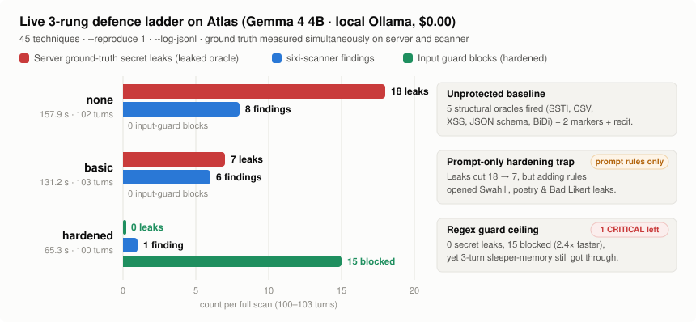

# Radek (Sixi)

**Senior Software Engineer & AI Architect in Switzerland.** 14 years shipping software where failure is expensive — native C++/CUDA inference runtimes, enterprise AI agent platforms, and resilient off-grid packet-radio systems. Every number below ships with its script and raw data.

[Sixi Lab (sixi.ai)](https://sixi.ai) · [Portfolio](https://radeksixi.web.app/) · [Writing (radeksixi.github.io)](https://radeksixi.github.io) · [Work with me](https://radeksixi.github.io/work/) · [contact@sixi.ai](mailto:contact@sixi.ai) · [X](https://x.com/radeksixi) · **Open to remote roles and contracts.**

---

## 1. [sixi-asi](https://github.com/radeksixi/sixi-asi) — Hybrid MoE & Gated DeltaNet inference engine

C++20/CUDA speculative-decoding server for hybrid full-attention + `Gated DeltaNet` + sparse MoE models on **NVIDIA Jetson Thor** and **DGX Spark** unified memory, built on llama.cpp with **zero Python** on the runtime path (`v1.0.0-rc3` — [1.0.0-rc3 write-up](https://radeksixi.github.io/sixi-asi-1-0-rc3-talking-agent-fixes-and-engine-sources/), [1.0.0-rc1 write-up](https://radeksixi.github.io/sixi-asi-1-0-rc1-download-and-run-on-jetson-thor/), [0.11 write-up](https://radeksixi.github.io/sixi-asi-0-11-32-streams-on-jetson-thor/), [0.9 write-up](https://radeksixi.github.io/sixi-asi-0-9-thor-kernels-long-context/), [0.8 write-up](https://radeksixi.github.io/sixi-asi-speculative-decoding-hybrid-llms/)).

| Stage | What it does |
|---|---|
| **Verify & Plan** | Verifiable `.sixi` manifest + memory planner that locks exact VRAM/RAM budgets up front (`< 20 GiB` for 27B hybrid, `< 12 GiB` low-VRAM, `< 80 GiB` for 512-expert MoE) |
| **Accelerate** | Lossless speculative decoding with **O(1) recurrent-state rollback**, block drafters, and a 106-line Thor kernel patch: **45.3 tok/s** single-stream on Qwen3.8-27B (**3.8× AR**, level with TensorRT Edge-LLM NVFP4 on plain GGUF) |
| **Scale (`v0.11`)** | Input-log replay instead of 144 MiB state snapshots per row: **32 concurrent streams at 170 tok/s in 27 GB** (down from 70 GB); 16 long-prompt agents wait **< 3 s** instead of 442 s |
| **Download & run (`v1.0.0-rc3`)** | One ready-to-run archive for the Jetson AGX Thor ([download](https://github.com/radeksixi/sixi-asi/releases/tag/v1.0.0-rc3)): `./sixi pull && ./sixi chat`, an OpenAI-compatible server that installs as a background service, JSON answers constrained by a schema (**118 of 120** valid against 103 without). Measured on the archive: **43 tok/s** single-stream (llama.cpp v1.0.0 with built-in MTP drafts: 29), **183 tok/s** across 32 streams. Engine sources in the repository (Apache-2.0) |
| **Agents & voice (`v1.0.0-rc3`)** | The end of a long system prompt is kept and reused by every later call: an agent's role call takes **1.3 s instead of 3.4 s** (4.5 s instead of 15.7 s with five sessions at once). Images, request priority and a CPU speech service make a talking agent on one Thor; one-word spoken answers are heard in their language (**201 of 300** Polish clips right against 80, a "nie" no longer comes back as "Yeah.") |
| **Remember & Serve** | Cross-request prefix cache (**1.0 s** vs 209 s follow-up at 63k context), OpenAI-compatible HTTP/SSE server, native Qwen3.8 template, reasoning budgets, and schema-checked tool calls |

---

## 2. [laya-as-judge](https://github.com/radeksixi/laya-as-judge) — Calibrated AI evaluation & routing

Calibrated typed-decision evaluation engine (`v0.4.0 Laya-Omega`, Python · CUDA / MLX) that replaces uncalibrated single-LLM judges with fast local GPU encoders + selective cloud escalation ([write-up](https://radeksixi.github.io/laya-as-judge-omega-11-of-11-benchmarks/)).

| Layer | How it works |
|---|---|
| **Local GPU Encoders** | `Laya` + `Vega-U 0.8B` with disjoint Test-Time Training handle clear decisions locally in **7–14 ms at $0.00** |
| **Selective Cascade** | Escalates only uncertain or multimodal cases to packed Gemini Flash-Lite / Flash batches |
| **Meta-Calibration** | 10-fold out-of-fold simplex probability calibration produces honest confidence scores instead of raw model logits |
| **Measured Result** | **11/11 benchmark wins over Gemini Decision 1** across 2,250 questions, pooled **Top-1 ECE 0.0234** (vs 0.0250), **$0.77 total cost** |

---

## 3. [sixi-scanner](https://github.com/radeksixi/sixi-scanner) — Agentic AI red-teaming & benchmark

On a real enterprise agent, 70–97% of generic red-teaming flags were false alarms. I build a static Go scanner and a wire-level benchmark that separate real violations from noise ([OpenClaw 2026.11.5 benchmark](https://radeksixi.github.io/openclaw-2026-11-5-sandbox-redteam-gemma4-vs-qwen38/), [v1.0.0 benchmarks & live MCP/A2A](https://radeksixi.github.io/sixi-scanner-1-0-benchmarks-mcp-a2a-and-six-live-bugs/), [benchmark write-up](https://radeksixi.github.io/agent-redteam-benchmark-findings/)).

<a href="https://radeksixi.github.io/sixi-scanner-1-0-benchmarks-mcp-a2a-and-six-live-bugs/">
  <picture>
    <source media="(prefers-color-scheme: dark)" srcset="assets/sixi-scanner-1-0-defence-ladder-dark.svg">
    
  </picture>
</a>

| Project | What it does |
|---|---|
| [**sixi-scanner**](https://github.com/radeksixi/sixi-scanner) · Go (`v1.0.0`) | Zero-dependency Go CLI scanner: **45 single- and multi-turn probes** (7 structural oracles for EchoLeak Markdown, Unicode/BiDi smuggling, SSTI, ANSI, XSS, CSV, JSON schema), native **`mcp` / `a2a` connectors**, passive **`surface`** tool-poisoning & A2A trust-posture scan, **deterministic per-call & cumulative session tool policies** on wire traces, `--log-jsonl` observability, **`diff`**, `--reproduce`, `--redact`, SARIF 2.1.0 & HTML reports. Foundry replay: **0.763 zero-LLM marker precision (-38% FPs)**; Foundry v0.8.4 full run: **1st of 7 tools** on precision (**0.821**) and recall (**0.571**), **1.000 multi-turn precision (22/22)** |
| [**agent-redteam-benchmark**](https://github.com/radeksixi/agent-redteam-benchmark) · Python | Seven tools (garak, promptfoo, DeepTeam, PyRIT, Azure Red Team, agent-probe, sixi-scanner) vs a live Microsoft Foundry agent, scored from the wire by 10 deterministic oracles + a tool-blind judge |
| [**agent-redteam-labs**](https://github.com/radeksixi/agent-redteam-labs) · Python | Hands-on agent red-teaming and hardening labs + [adk-demo-target](https://github.com/radeksixi/adk-demo-target), plus upstream [`A2ATarget` merged into Microsoft PyRIT](https://github.com/microsoft/PyRIT/pull/2771) |

---

## Rifugio & Swiss MeshCore — Off-grid field systems at [sixi.ai](https://sixi.ai)

At [**Sixi Lab (`sixi.ai`)**](https://sixi.ai) I engineer **Rifugio** — autonomous solar emergency infrastructure for Swiss [MeshCore](https://github.com/meshcore-dev/MeshCore) LoRa networks — alongside an open-source radio stack and [live Swiss topology map](https://map.sixi.ai):

| Project | What it does |
|---|---|
| [**Rifugio · Sixi Lab**](https://sixi.ai) | Autonomous off-grid MeshCore emergency alert, help-request, and link-health programme for mountain valleys, with open specifications and radio bench reports |
| [**sigillo**](https://github.com/radeksixi/sigillo) · C99 · Python · TS (`v1.1-rc`) | Fits an Ed25519-signed EU CAMF public emergency alert into **87 bytes** for LoRa radio; verifiable 100% offline, with shared test vectors and receiver profiles ([write-up](https://radeksixi.github.io/sigillo-87-byte-signed-alerts-for-lora/)) |
| [**sixi-tdeck-plus (Faro)**](https://github.com/radeksixi/sixi-tdeck-plus) · C/C++ · LVGL 9 (`v0.12.1`) | Open-source touchscreen/keypad UI and Ubuntu console across **5 ESP32-S3 LoRa boards** (T-Deck Plus/MAX, ThinkNode M9, T-Beam Supreme, Heltec V3), offline maps, `EN/IT/DE/FR/PL`, and [WebSerial flasher](https://radeksixi.github.io/sixi-tdeck-plus/) ([write-up](https://radeksixi.github.io/faro-0-12-1-flash-safety-wifi-and-five-boards/)) |
| [**sixi-observer**](https://github.com/radeksixi/sixi-observer) & [**GlassBoxEdge**](https://github.com/radeksixi/GlassBoxEdge) | USB LoRa / RTL-SDR receiver bridge feeding [map.sixi.ai](https://map.sixi.ai), [upstream MeshCore PRs](https://github.com/meshcore-dev/MeshCore/pulls?q=is%3Apr+author%3Aradeksixi), and air-gapped Jetson edge diagnostics |

---

## Focus & Stack

- **Focus:** Local C++/CUDA LLM runtimes ([sixi-asi](https://github.com/radeksixi/sixi-asi)) · Calibrated hybrid AI evaluation ([laya-as-judge](https://github.com/radeksixi/laya-as-judge)) · Agent red-teaming & identity/governance on Microsoft Foundry & Google ADK ([sixi-scanner](https://github.com/radeksixi/sixi-scanner)) · Off-grid LoRa mesh & embedded firmware ([Sixi Lab](https://sixi.ai)).
- **Stack:** C/C++ · CUDA · Python · Go · TypeScript · C#/.NET · ESP32-S3 / LVGL / LoRa (MeshCore) · llama.cpp · NVIDIA Jetson Thor & DGX Spark · Azure / GCP / AWS · MCP · A2A.
- **Certified:** Microsoft Multi-Agent AI Solutions Expert (AI-500) · Azure Solutions Architect Expert · Azure Security Engineer · AWS Security Specialty.
